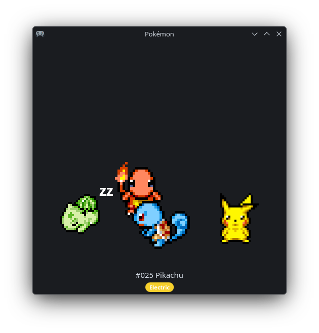

# Pokémon — widget para KDE Plasma 6

Pokémon animados passeando na sua área de trabalho. Os dados vêm da [PokeAPI](https://pokeapi.co) e as animações do [PMD Sprite Collab](https://sprites.pmdcollab.org).



*English: an animated Pokémon desktop widget for KDE Plasma 6. Add as many Pokémon as you like; they walk, idle, sleep and hop. Install with the command below.*

## Instalação rápida

```sh
curl -fLO https://github.com/Lulizza/plasma-pokemon-widget/releases/latest/download/pokemon-widget.plasmoid
kpackagetool6 -t Plasma/Applet -i pokemon-widget.plasmoid
```

Depois, clique com o botão direito na área de trabalho → **Adicionar widgets** → procure **"Pokémon"**.

Também dá para instalar pela interface: **Adicionar widgets → Obter novos widgets → Instalar a partir de arquivo local…** e escolher o `.plasmoid` baixado da [página de releases](https://github.com/Lulizza/plasma-pokemon-widget/releases).

**Atualizar** para uma versão nova:

```sh
kpackagetool6 -t Plasma/Applet -u pokemon-widget.plasmoid
systemctl --user restart plasma-plasmashell
```

**Remover:** `kpackagetool6 -t Plasma/Applet -r org.luiza.pokemonwidget`

## Recursos

- **Vários Pokémon ao mesmo tempo.** Adicione pelo nome ou número (`eevee`, `133`, `Mr. Mime`, `Nidoran♀`…) ou use o botão **Aleatório**.
- **Animações estilo Mystery Dungeon:** eles andam, ficam parados olhando para você, dormem (`zz`) e pulam quando você clica.
- **Shiny ✨ individual** para cada Pokémon.
- **5 estilos de sprite:** PMD animado, Showdown (GIF), pixel clássico, arte oficial e Pokémon HOME.
- **Fundo transparente** (pode ser trocado no modo de edição).
- **Funciona no painel:** mostra o Pokémon selecionado; a rodinha do mouse troca qual é.
- **Leve:**
  - pausa as animações quando uma janela maximizada cobre a área de trabalho;
  - guarda um cache local, então o login não depende de internet;
  - tenta de novo sozinho se a rede cair.

## Configurações

| Opção | O que faz |
|---|---|
| Meus Pokémon | Lista com ordem, Pokémon selecionado e shiny de cada um |
| Estilo do sprite | PMD (anda/dorme/pula), Showdown, pixel, arte oficial, HOME |
| Mostrar todos ao mesmo tempo | Todos passeiam juntos, ou só o selecionado aparece |
| Andar pela área do widget | Liga/desliga a caminhada |
| Pausar quando uma janela maximizada cobrir a área de trabalho | Economiza CPU e bateria |
| Mostrar nome e tipos | Exibe o nome, o número e os tipos do selecionado |
| Trocar automaticamente | Troca o selecionado a cada X minutos |

## Requisitos

- KDE Plasma 6.0 ou mais novo
- Internet na primeira vez que cada Pokémon é carregado

## Desenvolvimento

```sh
git clone https://github.com/Lulizza/plasma-pokemon-widget
cd plasma-pokemon-widget
kpackagetool6 -t Plasma/Applet -i .        # instala a partir do código (use -u para atualizar)
plasmawindowed org.luiza.pokemonwidget     # testa numa janela, sem mexer na área de trabalho
./scripts/package.sh                       # gera dist/pokemon-widget.plasmoid
```

Estrutura:

```
metadata.json                 identificação do widget
contents/config/main.xml      opções salvas
contents/ui/main.qml          widget (painel e área de trabalho)
contents/ui/Walker.qml        comportamento de cada Pokémon (andar, dormir, pular)
contents/ui/PmdSprite.qml     animação quadro a quadro das folhas do PMD
contents/ui/PokemonSprite.qml imagem/GIF da PokeAPI
contents/ui/pokeapi.js        PokeAPI (GraphQL + REST de reserva), cache e PMD
contents/ui/configGeneral.qml tela de configurações
```

## Créditos e licenças

- **Código:** [GPL-2.0-or-later](LICENSE).
- **Dados:** [PokeAPI](https://pokeapi.co).
- **Animações:** [PMD Sprite Collab](https://github.com/PMDCollab/SpriteCollab), licença [CC BY-NC 4.0](https://creativecommons.org/licenses/by-nc/4.0/). Por causa dessa licença, os sprites **não podem ser usados comercialmente**.
  - **Artistas de cada sprite:** o widget mostra quem fez o sprite de cada Pokémon, nas versões normal e shiny. O crédito aparece embaixo do nome, na dica do widget e na lista das configurações.
  - Os créditos são lidos dos arquivos `credits.txt` e `credit_names.txt` do SpriteCollab. Muitos sprites normais vêm dos jogos *Pokémon Mystery Dungeon* e por isso aparecem como **CHUNSOFT**.
  - A captura de tela acima mostra sprites de CHUNSOFT.
- O widget não inclui nenhum sprite: eles são baixados da PokeAPI e do SpriteCollab enquanto o widget roda. A captura de tela em `docs/` mostra sprites do PMD Sprite Collab, sob a mesma licença.
- Pokémon e os nomes dos Pokémon são marcas de Nintendo, Game Freak e The Pokémon Company. Este é um projeto de fã, gratuito e sem fins lucrativos, sem afiliação com essas empresas.
